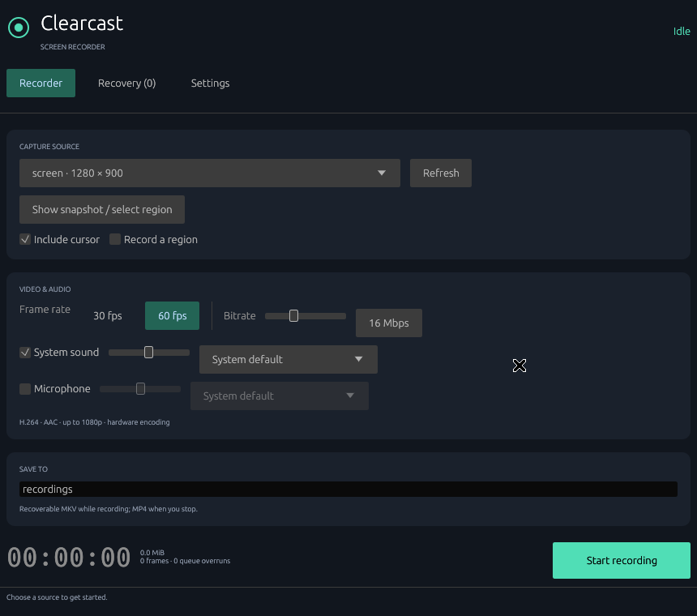

# Clearcast

A Rust screen recorder for Windows and Linux, with a shared egui desktop interface.

Clearcast targets **1080p at 60 fps using hardware H.264 encoding**. It records
to an interruption-tolerant MKV and remuxes to MP4 on Stop. Hardware performance
targets are goals, not measured guarantees; see [validation](docs/VALIDATION.md).

## Run

Install Rust stable, GStreamer 1.22+ and the platform media plugins, plus FFmpeg.
Detailed Windows/Linux instructions are in [BUILD.md](docs/BUILD.md).



```sh
cargo run --release
```

Choose a monitor/window, or use the screen-sharing dialog on Wayland. For a
region, open a snapshot and drag over it, or enter pixel coordinates. Enable
system audio and/or microphone, then start recording. Pause removes the paused
interval from both audio and video. Stop saves an MP4 without re-encoding.

Settings contains configurable global shortcuts. Defaults are Ctrl+Shift+F9
(start/stop) and Ctrl+Shift+F10 (pause/resume). Click **Apply global shortcuts**
to register them. Wayland needs a compatible GlobalShortcuts portal; local
F9/F10 defaults still work when the app has focus. The app keeps its control
window accessible and finalizes an active recording before closing.

## Included

- Windows Graphics Capture and DXGI desktop capture through Direct3D 11.
- Linux Wayland ScreenCast portal/PipeWire and X11 monitor/window capture.
- Hardware H.264 encoding, 30/60 fps, bitrate and cursor settings.
- System audio and microphone mixing, device selection, gain, AAC audio.
- Snapshot-based region selection; no continuously rendered live preview.
- Bounded capture queues, recording statistics, low-disk handling.
- Pause/resume, recovery journal, MP4 finalization, single-instance locking.
- CLI diagnostics, timed recording and recovery commands.

```sh
cargo run -- doctor
cargo run -- record --seconds 10 --output ./recordings
cargo run -- recover                  # list unfinished recordings
cargo run -- recover --all            # attempt recovery, retaining failed sources
cargo run -- diagnose --software --seconds 5 --pause --output ./diagnostics
```

Software encoding is available **only for explicitly requested synthetic
diagnostics**. Desktop recording does not silently fall back to CPU encoding.
No accounts, network service, telemetry or cloud storage are implemented.

## Platform limits

- Exclusive-fullscreen capture is best effort. On Windows try DXGI monitor
  capture; otherwise use borderless mode. There are no injected game hooks.
- Protected content cannot be captured. Wayland source choices, cursor modes
  and shortcuts depend on the compositor and portal implementation.
- Linux audio uses PipeWire's PulseAudio compatibility server (or PulseAudio),
  including its default output monitor. `pulsesrc` must be installed.
- GPU capture/encoding interoperability depends on drivers. Windows MF uses
  D3D11 textures; Linux VA uses GPU post-processing when compatible. X11 and
  unsupported interoperability paths require bounded staging/upload.
- GPU driver resets, source removal and storage errors stop and finalize the
  recording where possible. Disconnected audio branches are removed while
  video continues. Power-loss recovery can lose the final unwritten clusters.
- There is no tray icon, webcam overlay, editor, replay buffer or streaming.
- Rust bindings use GStreamer for native media handling, rather than duplicating
  the Windows/PipeWire/encoder implementations directly. This adds a runtime
  dependency and package size; it does not introduce a web UI.

## Develop

```sh
cargo fmt --all -- --check
cargo clippy --all-targets -- -D warnings
cargo test
# Requires media plugins and ffmpeg/ffprobe; includes actual media output and crash recovery.
xvfb-run -a cargo test --test media_integration -- --ignored --test-threads=1
```

The media integration tests are opt-in because they require encoders and an X11
display. Ordinary tests validate settings, region bounds and recovery safety.

See [architecture](docs/ARCHITECTURE.md), [release packaging](docs/BUILD.md#packaging)
and [third-party notices](THIRD_PARTY.md). MIT-licensed application source;
bundled components retain their own licenses.
